# 마녀의 공방 대사·이벤트 그래프 에디터 사용 설명서

> **Witch Workshop Dialogue & Event Graph Editor** 한국어 사용자 가이드
> 대상: Unity 개발 경험은 있지만, 노드 기반 대사 에디터는 처음 써 보는 분

> **문서 안내**
> - **이 문서**: 웹 에디터 사용법 (설치 → 그래프 작성 → 미리보기 → 저장 → Unity용 내보내기), 18장에 따라 하기 튜토리얼
> - **Unity에서 사용하기**: [`unity-package/Documentation~/GettingStarted_KO.md`](../unity-package/Documentation~/GettingStarted_KO.md) (내보낸 JSON을 Unity 6에서 재생하는 방법)
> - **영문 기술 문서**: [`README.md`](../README.md), [`docs/UNITY_INTEGRATION.md`](UNITY_INTEGRATION.md) (JSON 스키마), [`unity-package/README.md`](../unity-package/README.md)

이 문서의 화면 이미지는 실제 에디터(한국어 모드)를 브라우저에서 캡처한 것입니다. 이미지 속 샘플 대사는 영어로 되어 있는데, 이는 에디터에 내장된 샘플 프로젝트의 내용이기 때문입니다. (화면 문구는 한국어로 표시됩니다.)

---

## 목차

1. [소개와 전체 개요](#1-소개와-전체-개요)
2. [설치와 실행](#2-설치와-실행)
3. [화면 구성 이해하기](#3-화면-구성-이해하기)
4. [대사 그래프 만들고 관리하기](#4-대사-그래프-만들고-관리하기)
5. [노드 만들고 연결하기](#5-노드-만들고-연결하기)
6. [캐릭터 대사 편집하기](#6-캐릭터-대사-편집하기)
7. [선택지로 분기 만들기](#7-선택지로-분기-만들기)
8. [조건 노드 사용하기](#8-조건-노드-사용하기)
9. [전역 변수와 지역 변수 관리하기](#9-전역-변수와-지역-변수-관리하기)
10. [이벤트 노드 설정하기](#10-이벤트-노드-설정하기)
11. [미리보기로 대화 테스트하기](#11-미리보기로-대화-테스트하기)
12. [실행 취소·다시 실행·복사·붙여넣기·복제](#12-실행-취소다시-실행복사붙여넣기복제)
13. [프로젝트 저장과 불러오기](#13-프로젝트-저장과-불러오기)
14. [Unity용 JSON 내보내기](#14-unity용-json-내보내기)
15. [검증 오류와 경고 이해하기](#15-검증-오류와-경고-이해하기)
16. [자주 하는 실수와 문제 해결](#16-자주-하는-실수와-문제-해결)
17. [현재 제한 사항](#17-현재-제한-사항)
18. [실습 튜토리얼: 포션을 사러 온 손님](#18-실습-튜토리얼-포션을-사러-온-손님)
19. [부록: 단축키 · 용어 · 언어 전환](#19-부록-단축키--용어--언어-전환)

---

## 1. 소개와 전체 개요

**마녀의 공방 에디터**는 Unity 게임 *Witch Workshop*의 대화와 이벤트를 **그림(그래프)으로 설계**하는 웹 기반 도구입니다.

### 무엇을 할 수 있나요?

| 하고 싶은 일 | 에디터에서는 |
|---|---|
| 캐릭터가 말하는 대사를 순서대로 배치 | **대사** 노드를 만들고 선으로 연결 |
| 플레이어가 고르는 갈림길 | **선택지** 노드 (선택지마다 다른 길로 연결) |
| 호감도·골드 같은 값에 따라 다른 대화 | **조건** 노드 + **변수** |
| 대화 중 골드를 주고받거나 값을 바꿈 | **변수** 노드 |
| 상점 열기, 아이템 지급, 퀘스트 시작 등 게임 기능 호출 | **이벤트** 노드 |
| 대화 끝내기 (엔딩 이름 붙이기) | **종료** 노드 |
| Unity 없이 대화 흐름 시험 | **미리보기** |
| Unity에서 읽을 데이터 만들기 | **Unity 내보내기** (JSON) |

### 꼭 알아 둘 점 두 가지

1. **에디터 데이터와 Unity 데이터는 다릅니다.**
   - *프로젝트 파일*(`.witchproj.json`)은 노드 위치, 미리보기 설정 등 편집 정보까지 모두 담은 **작업 파일**입니다.
   - *내보내기 파일*(`.dialogue.json`)은 게임이 읽는 **실행용 데이터**입니다. 편집용 정보는 들어 있지 않습니다.
2. **시작 노드는 에디터 전용입니다.** 시작 노드 자체는 Unity로 내보내지지 않고, 시작 노드에 연결된 *첫 번째 노드*가 대화의 진입점이 됩니다.

백엔드 서버 없이 브라우저 안에서만 동작하며, 작업 내용은 사용자의 브라우저와 직접 저장한 파일에만 남습니다.

---

## 2. 설치와 실행

### 준비물

- **Node.js 18 이상** (개발은 Node 22에서 진행되었습니다)
- 최신 **Chromium 계열 브라우저**(Chrome, Edge 등). 개발과 확인은 Chromium에서 했습니다.
- Unity는 **필요 없습니다.**

### 설치와 실행

터미널에서 프로젝트 폴더로 이동한 뒤:

```bash
npm install        # 처음 한 번만: 필요한 패키지 설치
npm run dev        # 개발 서버 실행
```

브라우저에서 **http://localhost:5173** 을 엽니다. 터미널 창을 닫으면 에디터도 멈춥니다.

### 그 밖의 명령

```bash
npm test           # 자동 테스트 실행
npm run build      # 타입 검사 + 배포용 빌드 (dist 폴더 생성)
npm run preview    # 빌드 결과를 로컬에서 확인
```

> ⚠️ `dist/index.html`을 파일 탐색기에서 더블클릭해 열면 동작하지 않을 수 있습니다. 빌드 결과를 확인할 때는 `npm run preview`를 사용하거나 웹 서버로 제공하세요.

### 처음 실행하면

처음 열면 **샘플 프로젝트**(손님 대화 + 견습생 퀘스트)가 열려 있습니다. 자유롭게 눌러 보고 *미리보기*를 실행해 보세요. 나중에 상단의 **새로 만들기**로 빈 프로젝트를 시작할 수 있습니다.

---

## 3. 화면 구성 이해하기

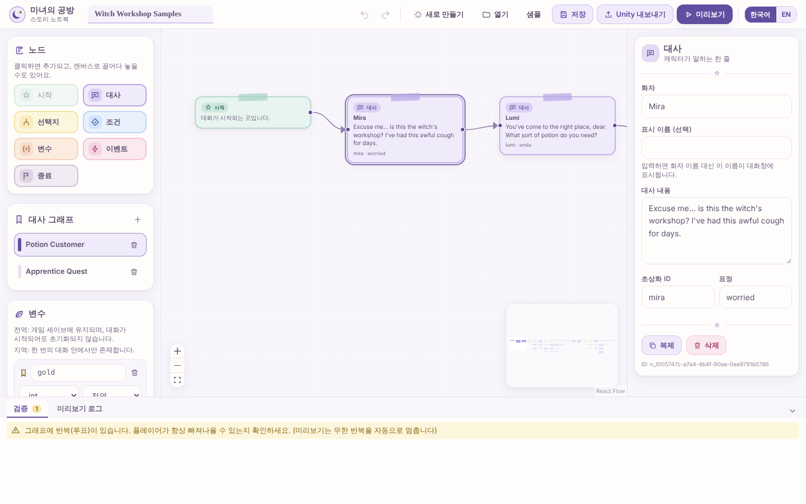

| 영역 | 위치 | 역할 |
|---|---|---|
| **상단 도구 모음** | 맨 위 | 프로젝트 이름, 실행 취소/다시 실행, 새로 만들기·열기·샘플·저장·Unity 내보내기·**미리보기**, 언어 전환 |
| **왼쪽 사이드바** | 왼쪽 | **노드**(추가할 노드 목록), **대사 그래프**(프로젝트 안의 그래프 목록), **변수**(변수 관리) |
| **캔버스** | 가운데 | 노드를 놓고 선으로 연결하는 작업 공간. 오른쪽 아래에 미니맵, 왼쪽 아래에 확대/축소·전체 보기 버튼 |
| **속성 편집** | 오른쪽 | 선택한 노드의 내용을 수정하는 패널 |
| **하단 패널** | 맨 아래 | **검증**(오류·경고 목록)과 **미리보기 로그** 탭 |

도구 모음만 따로 보면 다음과 같습니다.

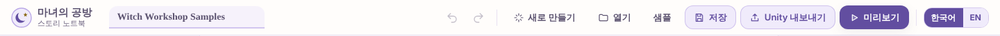

### 노드의 종류와 색상

| 노드 | 색 | 용도 |
|---|---|---|
| **시작** | 민트 | 대화의 출발점 (그래프당 1개, 에디터 전용) |
| **대사** | 라벤더 | 캐릭터가 말하는 한 줄 |
| **선택지** | 노랑 | 플레이어가 고르는 갈림길 |
| **조건** | 하늘색 | 변수 값에 따라 참/거짓으로 분기 |
| **변수** | 복숭아색 | 변수 값을 바꿈 |
| **이벤트** | 분홍 | 게임 이벤트 실행 |
| **종료** | 연보라(모브) | 대화 끝 |

### 노드 카드 읽는 법

- 노드 왼쪽의 **작은 원**은 *입력*, 오른쪽의 **작은 원**은 *출력*입니다. 선은 항상 *출력 → 다른 노드의 입력* 방향으로 연결합니다.
- **선택지** 노드는 선택지마다 출력이 하나씩 있습니다.
- **조건** 노드는 **참**(초록)과 **거짓**(분홍) 두 개의 출력이 있습니다.
- 노드 오른쪽 위의 작은 뱃지(⊗ 숫자 / ⚠ 숫자)는 그 노드의 **오류 / 경고 개수**입니다.

---

## 4. 대사 그래프 만들고 관리하기

하나의 **프로젝트**에는 여러 개의 **대사 그래프**를 넣을 수 있습니다. 보통 "대화 하나 = 그래프 하나"로 관리합니다. (예: 포션 손님, 견습생 퀘스트)

왼쪽 사이드바의 **대사 그래프** 패널에서:

| 하고 싶은 일 | 방법 |
|---|---|
| 그래프 추가 | 패널 제목 오른쪽 **＋** 버튼 → "대화 2" 같은 이름으로 새 그래프(시작 노드 포함)가 생깁니다 |
| 그래프 전환 | 목록에서 이름 왼쪽의 막대나 이름 칸을 클릭 |
| 이름 바꾸기 | 이름 칸에 직접 입력 |
| 삭제 | 오른쪽 휴지통 아이콘 → 확인 창 (**실행 취소로 되돌릴 수 있습니다**) |

- 프로젝트에는 **그래프가 최소 1개** 있어야 합니다. 마지막 하나는 삭제할 수 없습니다.
- **변수는 프로젝트 전체에서 공유**됩니다. 그래프마다 따로 만들 필요가 없습니다.
- 그래프 이름은 내보내기 파일 이름에도 쓰입니다. (예: `potion-customer.dialogue.json`, 한글 이름은 그대로 사용됩니다.)
- 프로젝트 이름은 상단의 이름 칸에서 바꿉니다.

---

## 5. 노드 만들고 연결하기

### 노드 추가

두 가지 방법이 있습니다.

1. **클릭**: 왼쪽 **노드** 목록의 항목을 클릭
   - 노드가 **하나만 선택**되어 있으면 → 그 노드 **바로 오른쪽**에 생깁니다. (대화를 오른쪽으로 이어 만들 때 편합니다)
   - 선택된 노드가 없으면 → 지금 보이는 캔버스의 **가운데**에 생깁니다.
   - 이미 노드가 있는 자리면 **아래로 비켜서** 겹치지 않게 놓입니다.
   - 새 노드가 화면 밖에 생기면 화면이 자동으로 따라갑니다.
2. **끌어다 놓기**: 목록의 항목을 캔버스의 원하는 위치로 드래그

> **시작** 노드는 그래프당 하나만 둘 수 있습니다. 이미 있으면 목록의 *시작* 항목이 회색으로 비활성화됩니다.

### 노드 이동과 선택

| 동작 | 방법 |
|---|---|
| 노드 이동 | 노드 본문을 드래그 (이동은 **실행 취소 한 번**으로 되돌려집니다) |
| 선택 | 노드 클릭 → 오른쪽 **속성 편집**에 내용이 표시됩니다 |
| 여러 개 선택 | `Ctrl`(Mac은 `⌘`)을 누른 채 클릭, 또는 `Shift`를 누른 채 빈 곳에서 드래그(영역 선택) |
| 화면 이동 | 빈 곳을 드래그 |
| 확대/축소 | 마우스 휠, 또는 왼쪽 아래 **＋ / −** 버튼 |
| 전체 보기 | 왼쪽 아래 맨 아래 버튼(네모 모양)을 누르면 그래프 전체가 한눈에 보입니다 |
| 미니맵 | 오른쪽 아래의 작은 지도. 드래그해서 이동할 수 있습니다 |

### 노드 연결

1. 연결을 **시작할 노드의 오른쪽 출력 원**에 마우스를 올립니다 (원이 살짝 커집니다).
2. 마우스를 누른 채로 **다음 노드의 왼쪽 입력 원**까지 드래그한 뒤 놓습니다.
3. 두 노드 사이에 화살표 선이 생깁니다.

규칙:

- **출력 하나에는 선이 하나만** 연결됩니다. 이미 연결된 출력에서 다른 노드로 새로 연결하면 이전 연결이 **교체**됩니다.
- **시작 노드로는 연결할 수 없습니다.** (시작 노드에는 입력 원이 없습니다)
- 선 위를 클릭해서 선택한 뒤 `Delete` 키를 누르면 연결이 끊어집니다.
- 입력은 여러 선을 받을 수 있습니다. (여러 길이 한 노드로 합쳐질 수 있어요)

### 시작 노드와 종료 노드

일곱 가지 노드 중 **대사·선택지·조건·변수·이벤트**는 6~10장에서 자세히 다룹니다. 나머지 두 가지는 대화의 처음과 끝을 표시합니다.

| 노드 | 규칙 | 설정 |
|---|---|---|
| **시작** (민트) | 그래프당 **정확히 하나**. 출력 원이 하나이고 입력은 없습니다. **에디터 전용**이라 Unity로 내보내지지 않으며, 여기에 연결된 첫 노드가 대화의 진입점이 됩니다. 연결이 없거나 둘 이상이면 오류입니다. | **메모** (에디터에서만 보이는 설명) |
| **종료** (연보라) | 출력이 **없습니다**. 한 그래프에 **여러 개** 둘 수 있고, 갈래마다 다른 엔딩으로 끝낼 수 있습니다. 대사·변수·이벤트의 출력이 비어 있으면 오류이므로, 대화를 끝내려면 종료 노드를 연결하세요. | **엔딩 이름** (미리보기 화면과 Unity 내보내기에 그대로 전달되어 게임 로직에서 엔딩을 구분하는 데 쓸 수 있습니다) |

### 키보드로 연결하기 · 핸들 더블클릭으로 연결 끊기

- **`Alt` + 방향키**: 노드를 하나만 선택한 상태에서 누르면, 그 방향(화면상 위치 기준)에서 가장 가까운 노드에 연결합니다. 그 방향에 연결할 노드가 없으면 아무 일도 일어나지 않습니다. (시작 노드는 입력이 없어 대상이 되지 않습니다.)
  - 출력이 하나뿐인 노드는 바로 연결되고, **선택지·조건 노드**는 어느 출력에 연결할지 작은 메뉴가 열립니다 (`↑`/`↓` + `Enter`, 숫자 키, `Esc`로 닫기).
  - 그 출력에 이미 다른 노드가 연결되어 있으면 덮어쓰기 전에 **확인 창**이 나옵니다.
  - 글자를 입력 중일 때는 동작하지 않습니다. 기존 연결 규칙(시작 노드로는 연결 불가 등)이 그대로 적용됩니다.
- **핸들(동그라미) 더블클릭**: 그 핸들에 붙은 연결만 끊습니다. 노드는 지워지지 않습니다. 입력 핸들에 연결이 여러 개면 어느 것을 끊을지 메뉴로 고릅니다. 클릭으로 연결을 시작한 상태에서 더블클릭하면 그 연결 동작만 취소되고 기존 연결은 유지됩니다.
- 연결 만들기·끊기는 모두 **실행 취소/다시 실행**에 포함됩니다.

### 노드·연결 삭제

노드를 선택하고 `Delete`(또는 `Backspace`) 키를 누르거나, 속성 편집 패널의 **삭제** 버튼을 누릅니다. 노드를 지우면 그 노드에 이어진 선도 함께 지워집니다. 실수했다면 **실행 취소**(`Ctrl+Z`)로 되돌릴 수 있습니다.

---

## 6. 캐릭터 대사 편집하기

**대사** 노드를 선택하면 오른쪽 **속성 편집**에서 다음 항목을 입력합니다.

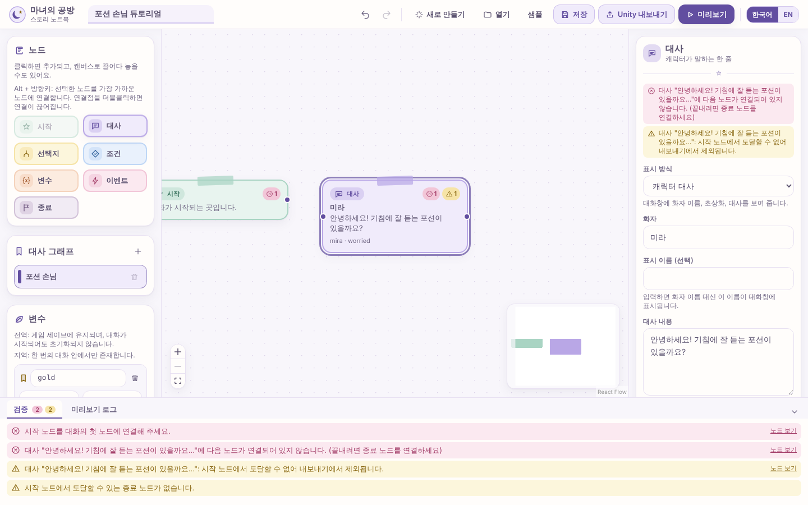

| 항목 | 설명 |
|---|---|
| **화자** | 말하는 캐릭터의 이름 (예: 미라) |
| **표시 이름 (선택)** | 비워 두면 *화자*가 대화창에 표시됩니다. 입력하면 **이 이름이 대신 표시**됩니다. (예: 화자는 `Customer`, 표시 이름은 `수상한 손님`) |
| **대사 내용** | 실제 대사. 여러 줄을 입력할 수 있습니다 |
| **초상화 ID** | 게임에서 어떤 초상화 이미지를 쓸지 가리키는 ID (예: `mira`). 에디터는 이미지를 보여 주지 않고 ID만 저장합니다 |
| **표정** | 표정 이름 (예: `worried`, `smile`). 기본값은 `neutral` |

- 대사 내용이 비어 있으면 **오류**, 화자가 모두 비어 있으면 **경고**가 표시됩니다.
- 대사 노드 아래쪽 출력은 **다음 노드**에 연결해야 합니다. 대화를 끝내려면 **종료** 노드를 연결하세요.
- 한글, 영어, 이모지 등 모두 입력할 수 있습니다.

---

## 7. 선택지로 분기 만들기

**선택지** 노드는 플레이어에게 여러 보기를 보여 주고, 고른 보기에 따라 **서로 다른 길**로 갑니다.

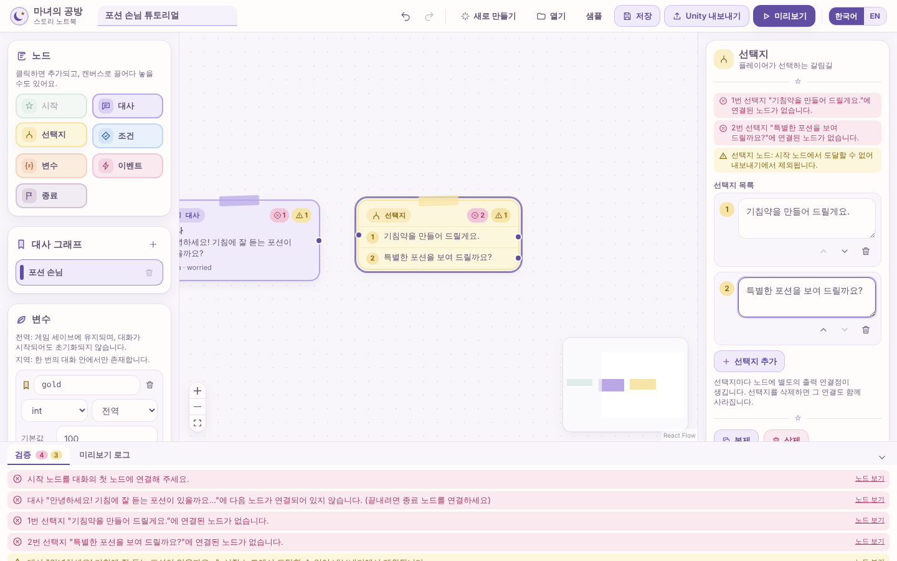

1. 선택지 노드를 추가하면 비어 있는 선택지 2개가 기본으로 들어 있습니다.
2. 속성 편집의 **선택지 1 내용**, **선택지 2 내용** 칸에 보기 문장을 입력합니다.
3. **선택지 추가**로 보기를 늘리고, 각 보기 아래의 **위로/아래로 이동**, **선택지 삭제** 아이콘으로 순서를 바꾸거나 지웁니다.
4. 노드 카드에는 선택지마다 **번호가 붙은 출력 원**이 생깁니다. 각 원을 서로 다른 노드에 연결하세요.

주의:

- 선택지를 **삭제**하면 그 선택지에 연결된 선도 함께 사라집니다.
- 선택지를 **위아래로 옮겨도** 연결은 유지됩니다. (선택지마다 고유 ID가 있어서 순서와 무관하게 연결을 기억합니다)
- 내용이 비었거나 연결이 없는 선택지는 **오류**로 표시됩니다.

---

## 8. 조건 노드 사용하기

**조건** 노드는 변수 값을 검사해서 **참**이면 위쪽 출력으로, **거짓**이면 아래쪽 출력으로 보냅니다.

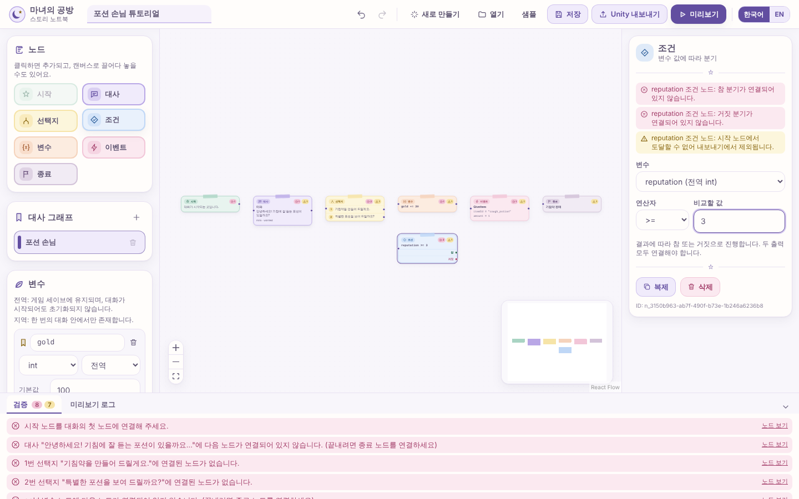

설정 항목:

| 항목 | 설명 |
|---|---|
| **변수** | 검사할 변수 (사이드바에서 만든 변수 목록에서 선택) |
| **연산자** | `==`(같다), `!=`(다르다), `>`, `<`, `>=`, `<=` |
| **비교할 값** | 비교 대상 값 |

규칙:

- **int(정수)** 변수는 여섯 가지 연산자를 모두 쓸 수 있습니다.
- **bool**과 **string** 변수는 `==`, `!=`만 쓸 수 있습니다.
- 비교할 값은 변수의 자료형과 같아야 합니다. (정수 변수와 문자열을 비교할 수 없어요)
- **참과 거짓 두 출력 모두** 연결해야 합니다. 하나라도 비어 있으면 오류입니다.
- 변수가 아직 하나도 없으면 "먼저 왼쪽 사이드바에서 변수를 만들어 주세요."라는 안내가 나옵니다.

> 💡 "골드가 50 이상이고 호감도가 3 이상일 때"처럼 **조건을 두 개 이상 묶는 기능(AND/OR)은 없습니다.** 조건 노드를 두 번 이어서 연결하세요. (참 → 다음 조건 노드)

---

## 9. 전역 변수와 지역 변수 관리하기

변수는 왼쪽 사이드바의 **변수** 패널에서 만들고 관리합니다.

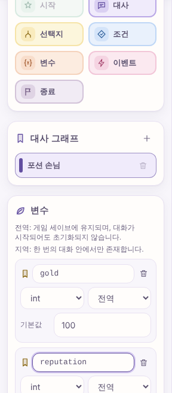

### 변수 만들기

1. **변수 추가** 버튼을 누르면 `variable`이라는 이름의 정수 변수가 생깁니다.
2. 이름 칸에 원하는 이름을 입력합니다. (예: `gold`)
3. **자료형**(`int` / `bool` / `string`)과 **범위**(전역 / 지역)를 고릅니다.
4. **기본값**(전역) 또는 **초기값**(지역)을 입력합니다.

**이름 규칙:** 영문자, 숫자, 밑줄(`_`)만 사용하고 숫자로 시작할 수 없습니다. 이름은 프로젝트 안에서 **중복되면 안 됩니다.** (Unity C# 코드에서 이름으로 다루기 쉽게 하려는 규칙입니다)

### 자료형

| 자료형 | 예 | 용도 |
|---|---|---|
| `int` | 100 | 골드, 호감도, 횟수 |
| `bool` | true / false | 플래그 (레시피를 배웠는가?) |
| `string` | "mira" | 이름, 상태 문자열 |

### 전역 변수와 지역 변수 — 가장 중요한 차이

| | **전역 (global)** | **지역 (local)** |
|---|---|---|
| 의미 | 게임 전체에서 유지되는 **영구 상태** (세이브 데이터와 연동) | **이번 대화 안에서만** 존재 |
| 대화가 시작될 때 | **초기화되지 않습니다** | 초기값으로 초기화됩니다 |
| 대화가 끝나면 | 값이 게임에 계속 남습니다 | 값이 사라집니다 |
| "기본값/초기값"의 의미 | 게임 저장소에 **값이 아직 없을 때만** 쓰는 대비용 값 | 대화 시작 시 값 |
| 예 | `gold`, `reputation`, `knowsCoughRecipe` | `haggle`(이번 흥정 횟수) |

즉, 전역 변수의 "기본값"은 "대화 시작할 때마다 이 값으로 되돌려라"가 **아닙니다.** Unity 쪽에서 세이브 데이터가 값을 제공하고, 값이 없을 때만 기본값을 씁니다.

### 변수 이름 바꾸기·자료형 바꾸기·삭제

- **이름을 바꾸면** 그 변수를 쓰는 모든 조건/변수 노드가 **자동으로 새 이름으로 바뀝니다.**
- **자료형을 바꾸면** 기본값/초기값은 새 자료형의 기본 값(`0`, `false`, 빈 문자열)으로 초기화되고, 그 변수를 쓰는 노드에 설정된 값은 새 자료형에 맞게 변환됩니다. (예: 정수 `30` → 문자열 `"30"`) 연산자/동작도 새 자료형에서 쓸 수 있는 것으로 조정됩니다.
- **삭제**할 때 현재 그래프의 노드가 그 변수를 쓰고 있으면 확인 창이 뜹니다. 삭제하면 해당 노드는 "정의되지 않은 변수" 오류가 됩니다. (실행 취소로 복구 가능)

### 변수 노드: 값 바꾸기

**변수** 노드는 대화 도중 변수 값을 바꿉니다.

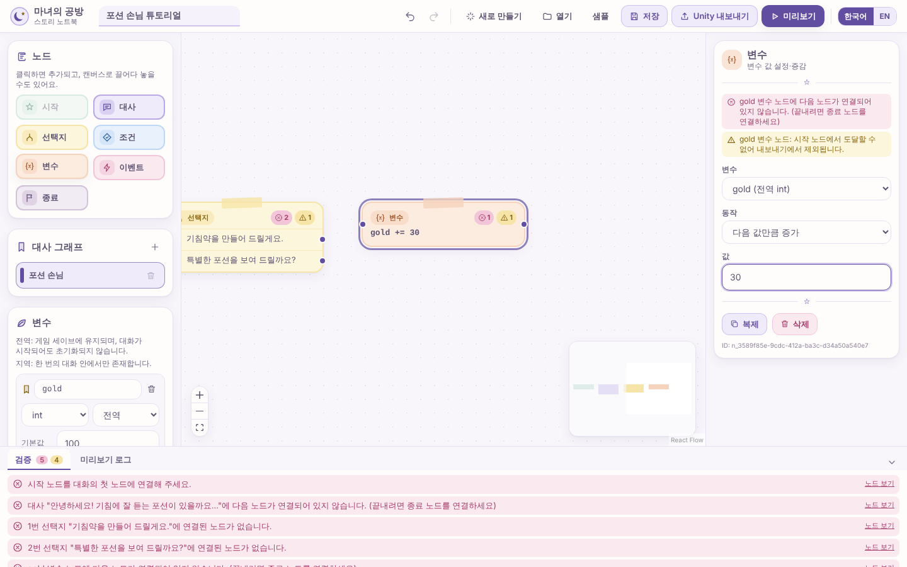

| 동작 | 설명 | 사용 가능한 자료형 |
|---|---|---|
| **다음 값으로 설정** | 값을 그대로 덮어씁니다 | int, bool, string |
| **다음 값만큼 증가** | 더하기 | int |
| **다음 값만큼 감소** | 빼기 | int |

`bool` 변수에서는 "설정"만 쓸 수 있고 `(플래그)`라고 표시됩니다. (플래그 켜기 = `true`로 설정)

---

## 10. 이벤트 노드 설정하기

**이벤트** 노드는 대화 중에 **게임의 기능을 호출**합니다. 에디터는 "이벤트 이름 + 파라미터"만 기록하고, 실제 동작은 Unity 쪽 코드에서 그 이름에 맞춰 구현합니다.

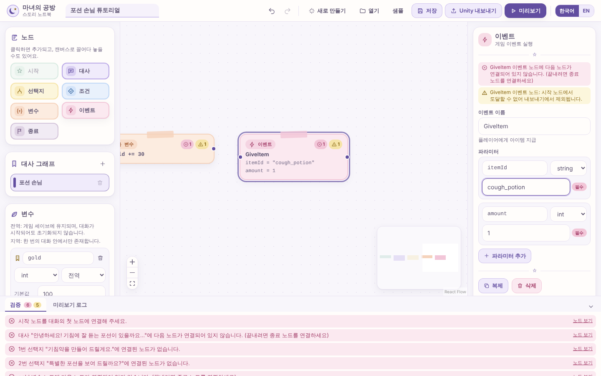

### 기본 제공 이벤트

이벤트 이름 칸을 클릭하면 자동 완성 목록이 나타납니다. 목록에서 고르면 **필수 파라미터가 자동으로 채워집니다.**

| 이벤트 이름 | 하는 일 | 필수 파라미터 |
|---|---|---|
| `OpenShop` | 상점 창 열기 | `shopId` (string) |
| `GiveItem` | 플레이어에게 아이템 지급 | `itemId` (string), `amount` (int) |
| `StartQuest` | 퀘스트 시작 | `questId` (string) |
| `CompleteQuest` | 퀘스트 완료 | `questId` (string) |
| `ChangeScene` | 다른 씬으로 이동 | `sceneName` (string) |
| `UnlockRecipe` | 포션 레시피 해금 | `recipeId` (string) |

> 이벤트 **이름은 번역되지 않습니다.** Unity 코드와 정확히 일치해야 하는 식별자이기 때문입니다. (설명 문구만 한국어로 표시됩니다)

### 파라미터 편집

- 각 파라미터는 **키**, **자료형**(string/int/bool), **값**으로 이루어집니다.
- 기본 이벤트의 필수 파라미터는 키를 바꾸거나 지울 수 없고 **필수** 표시가 붙습니다. 값만 입력하세요. (문자열 필수 파라미터를 비워 두면 오류입니다)
- **파라미터 추가**로 원하는 만큼 더할 수 있습니다. 같은 키를 두 번 쓸 수 없습니다.

### 나만의 이벤트

목록에 없는 이름(예: `PlaySound`)을 직접 입력해도 됩니다. 이 경우 "사용자 정의 이벤트입니다. Unity 핸들러는 이 이름과 정확히 일치하게 등록해야 합니다."라는 안내가 나오며, 파라미터는 직접 추가합니다. Unity에서는 같은 이름으로 핸들러를 등록하면 됩니다. (자세한 예: [`UNITY_INTEGRATION.md`](UNITY_INTEGRATION.md))

---

## 11. 미리보기로 대화 테스트하기

상단의 보라색 **미리보기** 버튼을 누르면 Unity 없이 대화를 실제처럼 시험해 볼 수 있습니다.

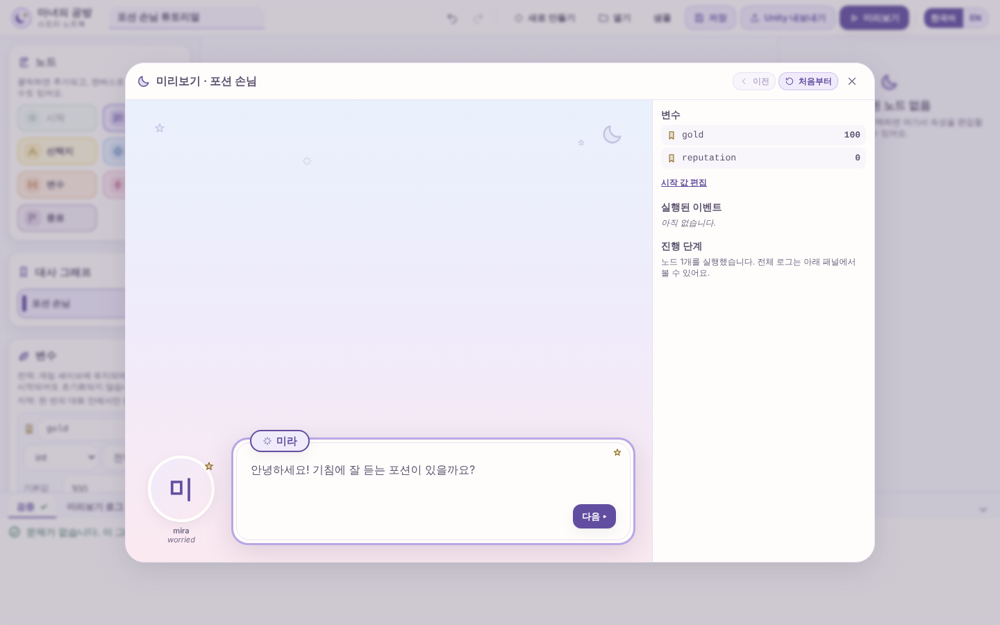

### 화면 구성

- **왼쪽 무대**: 이름표(리본), 초상화 자리, 대사 상자. 초상화는 이미지가 없으므로 화자 이름의 첫 글자가 들어간 원으로 표시되고, 아래에 초상화 ID와 표정이 적힙니다.
- **오른쪽 패널**:
  - **변수**: 현재 변수 값. 값이 **바뀐 변수는 노란색**으로 강조됩니다.
  - **시작 값 편집**: 시작 값을 바꿔서 시험합니다 (아래 참고)
  - **실행된 이벤트**: 지금까지 발생한 이벤트와 파라미터
  - **진행 단계**: 실행된 노드 수

### 진행 방법

| 버튼 | 동작 |
|---|---|
| **다음 ▸** | 다음 대사로 |
| 선택지 버튼 | 그 선택지를 고른 것으로 진행 |
| **이전** | 한 단계 되돌리기 (변수·이벤트도 함께 되돌아갑니다) |
| **처음부터** | 처음부터 다시 시작 |
| **다시 하기** | 엔딩 화면에서 처음부터 |
| ✕ / `Esc` | 미리보기 닫기 |

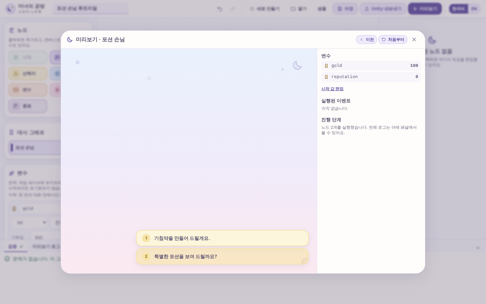

대화가 끝나면 **"끝 / 엔딩: (엔딩 이름)"** 화면이 나옵니다.

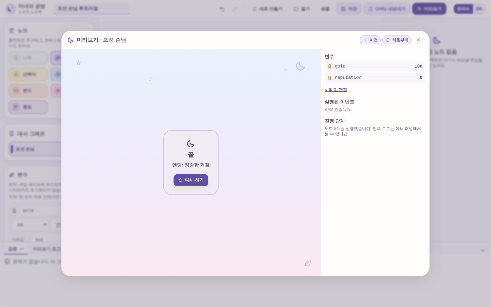

### 시작 값 바꿔서 시험하기

조건 분기를 모두 확인하려면 변수의 시작 값을 바꿔 봐야 합니다. 오른쪽 패널의 **시작 값 편집**을 누르고 값을 바꾸면 **자동으로 처음부터 다시 시작**합니다.

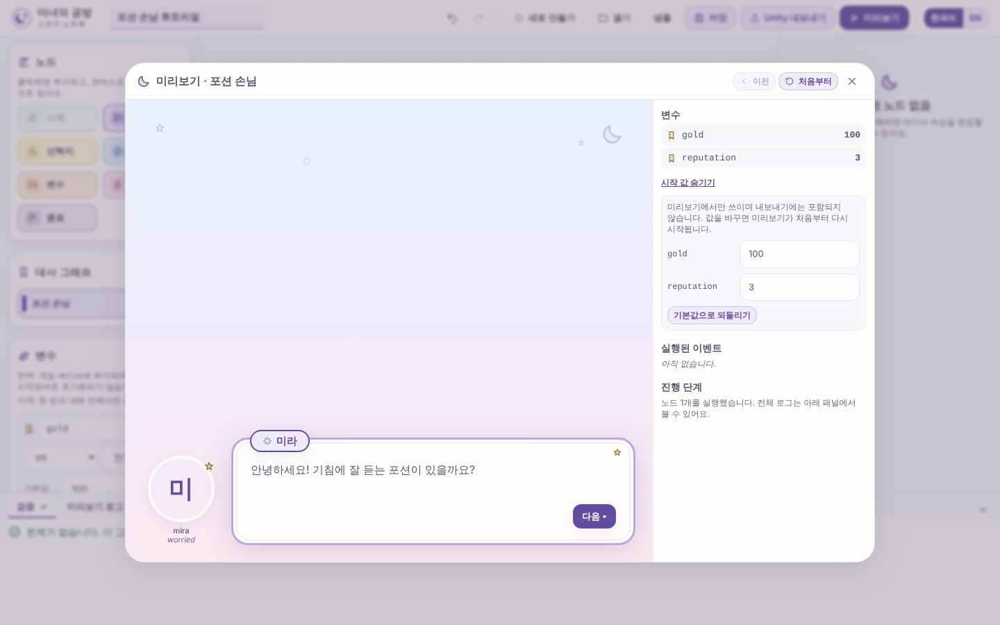

- 이 값은 **미리보기 전용**이며 Unity 내보내기에는 **포함되지 않습니다.**
- **기본값으로 되돌리기**로 원래 값으로 돌아갑니다.
- 전역·지역 변수 모두 바꿀 수 있습니다.
- 시작 값은 프로젝트 파일에 저장되어 다음에 열어도 유지됩니다.

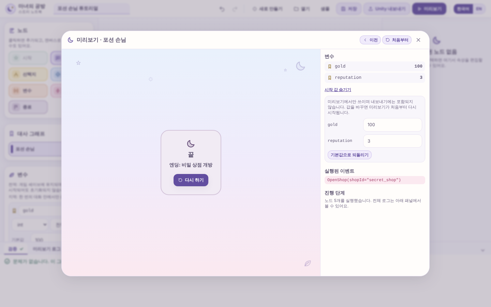

### 문제를 자동으로 잡아 줍니다

미리보기는 다음 상황에서 **오류 화면**을 보여 주고 멈춥니다. 이때 **그래프에서 노드 보기** 버튼으로 문제 노드로 바로 이동할 수 있습니다.

- 연결이 끊어졌거나 존재하지 않는 노드로 이어진 경우
- 시작 노드에 연결이 없거나 시작 노드가 없는 경우
- 정의되지 않은 변수를 쓰는 경우, 자료형이 맞지 않는 조건/변수 연산
- **무한 반복**: 플레이어 입력 없이 자동 노드(조건/변수/이벤트)만 200번 이상 이어지면 중단합니다. (선택지나 대사를 거치는 반복은 정상입니다)

### 미리보기 로그

미리보기를 닫은 뒤에도 아래 패널의 **미리보기 로그** 탭에서 대사, 선택, 조건 판정, 변수 변화, 이벤트를 시간순으로 볼 수 있습니다.

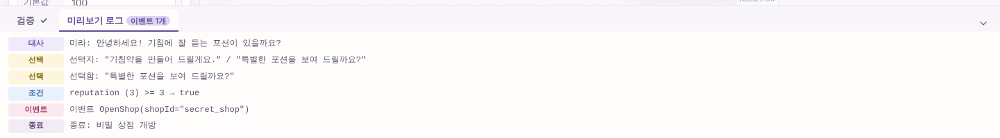

---

## 12. 실행 취소·다시 실행·복사·붙여넣기·복제

### 실행 취소 / 다시 실행

- 도구 모음의 화살표 버튼 또는 `Ctrl+Z`(취소), `Ctrl+Shift+Z` 또는 `Ctrl+Y`(다시 실행)
- 취소 단위는 이렇게 정해져 있습니다.
  - 노드를 **끌어서 옮기기**: 놓을 때까지가 **한 번**
  - **글자 입력**: 같은 칸에 이어서 입력하는 동안(약 1초 이내)은 **한 번**
  - 노드 추가/삭제, 연결, 변수 추가/수정 등: 각각 **한 번**
- 최대 100단계까지 기록됩니다.
- ⚠️ **새로 만들기, 열기, 샘플** 은 프로젝트 자체를 바꾸는 작업이라 실행 취소 기록이 **초기화**됩니다.

### 복사 / 붙여넣기 / 복제

| 동작 | 단축키 | 설명 |
|---|---|---|
| 복사 | `Ctrl+C` | 선택한 노드와, 그 노드들끼리 이어진 선을 복사 |
| 붙여넣기 | `Ctrl+V` | 조금 비켜난 위치에 붙여넣기 (연속으로 붙여넣으면 계속 비켜납니다) |
| 복제 | `Ctrl+D` 또는 **복제** 버튼 | 복사+붙여넣기를 한 번에 |

- 붙여넣을 때 노드·선택지·선의 **ID가 모두 새로 만들어집니다.** 그래서 원본과 섞이지 않습니다.
- **선택한 노드 안쪽 연결만** 복사됩니다. 선택 밖의 노드로 향하던 선은 복사되지 않습니다.
- **시작 노드는 복사/복제되지 않습니다.** (그래프당 하나)
- 복사한 내용은 **그래프를 바꿔도** 붙여넣을 수 있어서, 다른 그래프로 노드를 옮길 때 편리합니다.
- 입력 칸(글자 입력 중)에서는 단축키가 동작하지 않고 일반 텍스트 편집이 우선합니다.

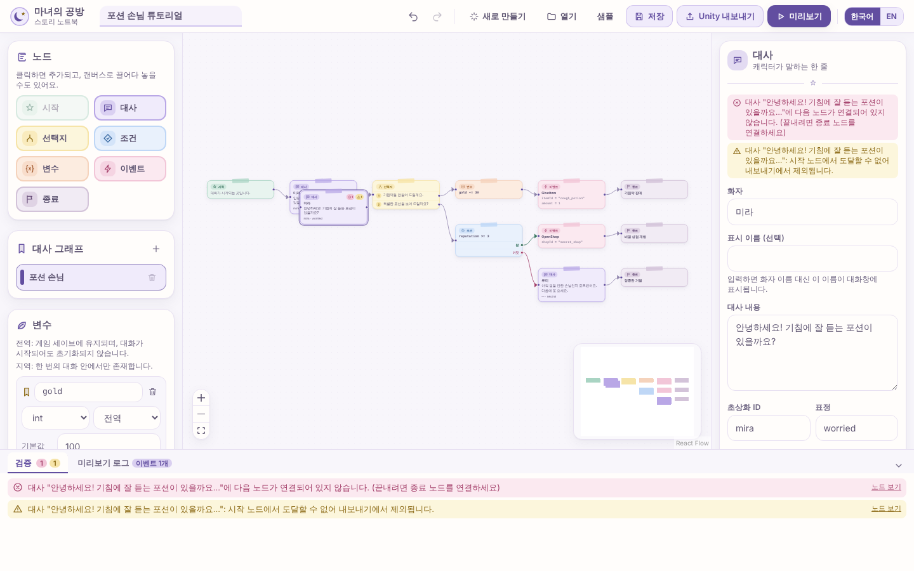

---

## 13. 프로젝트 저장과 불러오기

### 파일로 저장

상단 **저장** 버튼(또는 `Ctrl+S`)을 누르면 `프로젝트이름.witchproj.json` 파일이 다운로드됩니다. 프로젝트 이름의 한글은 그대로 파일 이름에 쓰입니다.


- **저장 위치와 파일 이름을 직접 고를 수 있는 브라우저**(Chrome·Edge 등)에서는 저장 대화상자가 열립니다. 이름은 `.witchproj.json` 확장자로 제안됩니다. **대화상자를 취소하면** 파일도 편집 내용도 그대로이며 "저장했다"는 메시지도 나오지 않습니다.
- 이 기능을 지원하지 않는 브라우저(Firefox·Safari 등)에서는 예전처럼 브라우저의 다운로드 폴더로 내려받고, "다운로드했습니다"로 안내합니다.
- 브라우저 자동 저장(복구용)은 이와 별개로 계속 동작합니다.

- 모든 그래프, 변수, 노드 위치, 미리보기 시작 값이 담깁니다.
- **저장 → 열기 → 다시 저장**을 해도 파일 내용이 달라지지 않습니다. (손실 없음)
- 파일은 사람이 읽을 수 있는 JSON이므로 Git으로 버전 관리하기 좋습니다.

### 파일 열기

**열기** → 파일 선택. 현재 작업은 열린 파일의 내용으로 **대체**됩니다(되돌리기 기록도 초기화). 파일이 잘못되었으면 이유를 알려 주는 오류가 표시되고 현재 작업은 그대로 유지됩니다. 예:

> 파일을 열 수 없습니다: 마녀의 공방 프로젝트 파일이 아닙니다.

### 자동 저장과 복구

- 작업 내용은 **브라우저 안에 자동 저장**됩니다. (입력을 멈추고 약 0.5초 뒤, 그리고 탭을 닫거나 숨길 때)
- 새로고침하거나 브라우저를 다시 열면 상단에 **"마지막으로 자동 저장된 작업을 복원했습니다."** 안내가 나옵니다. 거기서 **빈 프로젝트로 시작** 또는 **샘플 불러오기**를 선택할 수도 있습니다.
- 저장소를 쓸 수 없거나 용량이 가득 차면 빨간 안내가 표시됩니다. 이때는 **파일로 저장**을 꼭 해 주세요.
- 자동 저장은 **브라우저 한 곳, 슬롯 하나**입니다. 다른 컴퓨터나 다른 브라우저와는 공유되지 않으므로, 중요한 작업은 **저장 버튼으로 파일을 보관**하세요.
- 저장된 데이터가 손상된 경우에는 지우지 않고 별도 위치에 백업해 둡니다.

---

## 14. Unity용 JSON 내보내기

상단 **Unity 내보내기** 버튼은 **현재 열려 있는 그래프 하나**를 `그래프이름.dialogue.json`으로 내려받게 합니다.

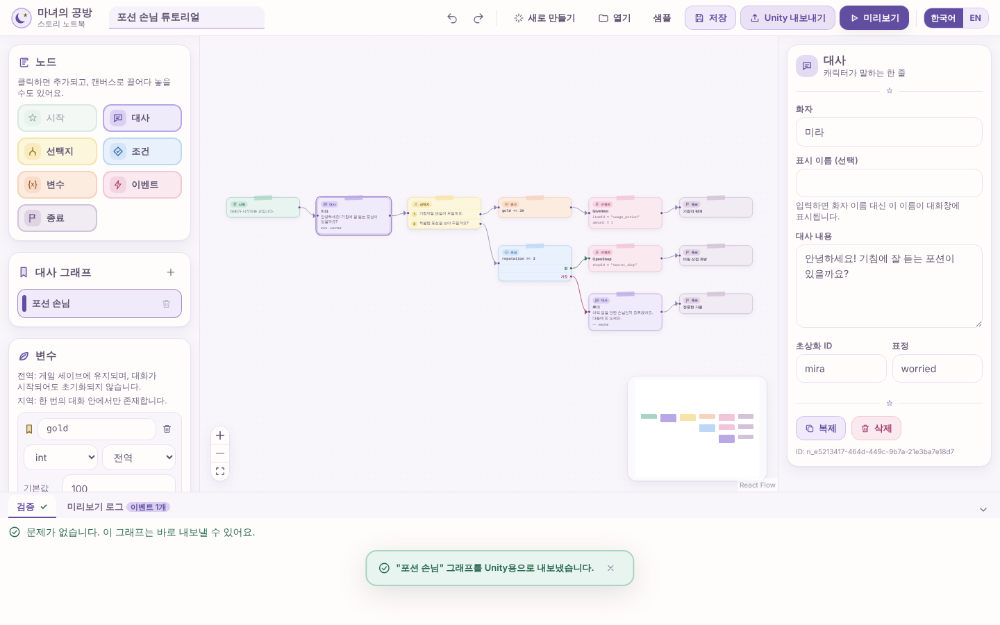

저장과 마찬가지로 지원하는 브라우저에서는 저장 위치·파일 이름을 고르는 대화상자(`.dialogue.json`)가 열리고, 취소하면 아무것도 저장되지 않으며, 미지원 브라우저에서는 다운로드로 대체됩니다.

### 내보내기 규칙

1. **오류가 하나라도 있으면 내보내기가 중단됩니다.** 오류 개수를 알려 주고 검증 패널을 열어 줍니다. 잘못된 데이터가 정상 데이터처럼 내보내지는 일은 없습니다.
2. **경고만 있을 때**는 "경고가 N개 있습니다. 그래도 내보낼까요?" 확인 창이 나옵니다.
3. **시작 노드는 내보내지지 않습니다.** 파일의 `startNodeId`는 시작 노드가 가리키는 **첫 실행 노드**의 ID입니다.
4. 시작 노드에서 **도달할 수 없는 노드는 제외**됩니다. (경고로 미리 알려 줍니다)
5. 그 그래프가 **실제로 사용하는 변수만** 파일에 들어갑니다. 전역/지역 구분이 함께 기록됩니다.
6. 노드 ID와 선택지 ID는 UUID 기반이며, 같은 그래프를 다시 내보내도 **그대로 유지**됩니다.

### 파일 모양 (요약)

```json
{
  "schemaVersion": 1,
  "id": "g_…",
  "name": "포션 손님",
  "startNodeId": "n_…",
  "variables": [
    { "name": "gold", "scope": "global", "valueType": "int",
      "initial": { "valueType": "int", "intValue": 100, "boolValue": false, "stringValue": "" } }
  ],
  "nodes": [
    { "id": "n_…", "type": "dialogue", "speaker": "미라", "displayName": "미라", "text": "…", "next": "n_…", "…": "…" }
  ]
}
```

핵심 설계 (Unity `JsonUtility`로 바로 읽을 수 있도록):

- 모든 노드가 **같은 필드 집합**을 갖고, 쓰지 않는 필드는 `""`, `0`, `false`, `[]`입니다. `null`이 없습니다.
- 값은 `valueType`과 `intValue / boolValue / stringValue` 세 칸으로 **명시적**으로 저장합니다. (한 필드에 숫자·불린·문자열이 섞이지 않습니다)
- `type`(노드 종류), 필드 이름, 이벤트 이름, 변수 이름은 **번역되지 않는 식별자**입니다. 한국어 모드로 내보내도, 영어 모드로 내보내도 **파일 내용이 완전히 동일**합니다.

전체 스키마, C# 클래스 정의, 대화 실행기 예제, 이벤트 등록 방법은 [`docs/UNITY_INTEGRATION.md`](UNITY_INTEGRATION.md)를 보세요.

> 💡 **Unity에서 재생하기**: 내보낸 파일을 Unity 6에서 실제로 표시하는 방법(패키지 설치, DialogueManager·DialogueUI 설정, 캐릭터 초상화, 게임 이벤트, 세이브 연동)은 [Unity 시작 가이드](../unity-package/Documentation~/GettingStarted_KO.md)에 단계별로 정리되어 있습니다. 이 튜토리얼(18장)의 결과물이 그 가이드의 예제로 이어집니다.

### Unity에서 읽기 (한눈에 보기)

```csharp
var data = JsonUtility.FromJson<DialogueData>(textAsset.text);   // DialogueData 클래스는 UNITY_INTEGRATION.md 참고
```

> `operator` 필드는 C# 예약어이므로 클래스에서는 `@operator`로 선언합니다. 자세한 내용은 통합 가이드에 있습니다.

---

## 15. 검증 오류와 경고 이해하기

에디터는 편집할 때마다 **자동으로 그래프를 검사**합니다.

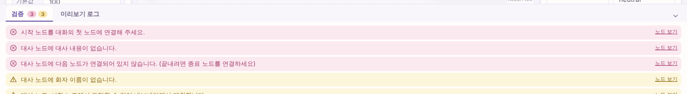

### 읽는 법

- **빨간색 = 오류**: 해결해야 내보낼 수 있습니다.
- **노란색 = 경고**: 내보내기는 가능하지만 확인이 필요합니다.
- 하단 **검증** 탭 제목 옆의 숫자는 오류/경고 개수입니다. 문제가 없으면 ✓가 표시됩니다.
- 목록의 항목이나 **노드 보기**를 클릭하면 **해당 노드로 화면이 이동**하고 선택됩니다.
- 노드를 선택하면 속성 편집 맨 위에 **그 노드의 문제만** 보입니다. 노드 카드의 ⊗/⚠ 뱃지에 마우스를 올려도 내용을 볼 수 있습니다.

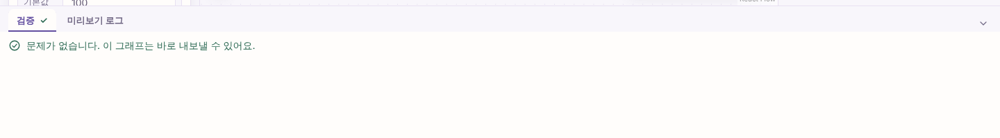

### 자주 보는 메시지와 해결 방법

| 메시지(요약) | 심각도 | 원인 | 해결 |
|---|---|---|---|
| 시작 노드가 없습니다 | 오류 | 시작 노드를 지웠음 | **노드** 목록에서 **시작** 추가 |
| 시작 노드는 하나만 둘 수 있습니다 | 오류 | 시작 노드가 둘 이상 | 하나를 삭제 |
| 시작 노드를 대화의 첫 노드에 연결해 주세요 | 오류 | 시작 노드의 출력이 비어 있음 | 시작 → 첫 노드 연결 |
| …에 다음 노드가 연결되어 있지 않습니다 | 오류 | 대사/변수/이벤트의 출력이 비어 있음 | 다음 노드 또는 **종료** 연결 |
| …에 대사 내용이 없습니다 | 오류 | 대사 텍스트가 빔 | 내용 입력 |
| 화자 이름이 없습니다 | 경고 | 화자와 표시 이름이 모두 빔 | 화자 입력 |
| N번 선택지에 내용이 없습니다 | 오류 | 선택지 텍스트가 빔 | 내용 입력 또는 선택지 삭제 |
| N번 선택지에 연결된 노드가 없습니다 | 오류 | 선택지 출력이 비어 있음 | 선택지마다 연결 |
| 조건 노드에 변수가 선택되지 않았습니다 | 오류 | 변수 미선택 | 변수 선택 |
| 정의되지 않은 변수를 사용합니다 | 오류 | 지워졌거나 오타 | 변수 패널에서 정의하거나 노드의 변수를 다시 선택 |
| …변수에는 "…" 연산자를 사용할 수 없습니다 | 오류 | bool/string에 `>` 등을 사용 | `==` 또는 `!=` 사용 |
| …자료형이 다른 값과 비교하고 있습니다 | 오류 | 변수와 비교 값의 자료형 불일치 | 비교할 값을 다시 입력 |
| 참/거짓 분기가 연결되어 있지 않습니다 | 오류 | 조건의 출력 중 하나가 비어 있음 | 두 출력 모두 연결 |
| 필수 파라미터가 없습니다 / …값을 입력해야 합니다 | 오류 | 이벤트의 필수 파라미터 누락 | 파라미터 입력 |
| 이벤트 이름이 없습니다 | 오류 | 이벤트 이름 비어 있음 | 이름 입력 |
| 변수 이름이 중복되었습니다 / 사용할 수 없는 문자 | 오류 | 변수 이름 규칙 위반 | 변수 이름 수정 |
| 시작 노드에서 도달할 수 없어 내보내기에서 제외됩니다 | 경고 | 어디에서도 연결되지 않은 노드 | 연결하거나 삭제 |
| 도달할 수 있는 종료 노드가 없습니다 | 경고 | 대화가 끝나지 않음 | **종료** 노드 연결 |
| 그래프에 반복(루프)이 있습니다 | 경고 | 선이 앞쪽으로 되돌아감 | 의도한 반복이면 무시해도 됩니다. 플레이어가 빠져나올 길이 있는지 확인 |

> "루프" 경고는 **일부러 만든 반복**(예: 흥정을 계속하는 장면)에도 표시됩니다. 샘플의 *Potion Customer*에서도 볼 수 있습니다.

---

## 16. 자주 하는 실수와 문제 해결

| 증상 | 원인과 해결 |
|---|---|
| **노드가 화면에 안 보여요** | 화면 밖에 있을 수 있습니다. 왼쪽 아래 **전체 보기** 버튼을 누르거나, 하단 검증 목록에서 **노드 보기**를 누르세요. |
| **선이 연결되지 않아요** | 출력 원(오른쪽)에서 입력 원(왼쪽)으로 드래그해야 합니다. 시작 노드로는 연결할 수 없고, 끝 노드는 출력이 없습니다. 노드 가장자리 근처에서 놓아 보세요. |
| **선을 다시 연결했더니 이전 선이 사라졌어요** | 출력 하나에는 선이 **하나만** 허용되어 새로 연결하면 교체됩니다. 의도된 동작입니다. |
| **노드를 추가했는데 시작 노드가 안 늘어요** | 시작 노드는 그래프당 1개입니다. |
| **Delete 키로 글자를 지우려는데 노드가 삭제돼요** | 입력 칸을 클릭해서 커서가 있는 상태에서는 노드 삭제가 동작하지 않습니다. 그래도 실수했다면 `Ctrl+Z`. |
| **내보내기가 중단돼요** | 오류가 남아 있습니다. 하단 검증 패널에서 빨간 항목을 해결하세요. |
| **미리보기에서 "무한 반복" 오류가 나요** | 조건/변수/이벤트 노드만으로 한 바퀴를 도는 구조입니다. 사이에 대사나 선택지를 넣거나, 종료 조건이 되도록 변수를 증가시키세요. |
| **미리보기에서 특정 엔딩이 안 나와요** | 조건이 항상 같은 쪽으로 판정되는 것일 수 있습니다. 미리보기의 **시작 값 편집**으로 변수 값을 바꿔 보세요. |
| **새로고침했더니 작업이 복원됐어요 / 사라졌어요** | 자동 저장은 이 브라우저에만 저장됩니다. 시크릿 모드, 브라우저 데이터 삭제, 다른 브라우저에서는 복원되지 않습니다. 중요한 작업은 **저장**으로 파일을 보관하세요. |
| **파일을 열 수 없다고 나와요** | 이 에디터에서 저장한 `.witchproj.json` 파일만 열 수 있습니다. Unity용 `.dialogue.json`은 **열 수 없습니다**(내보내기 전용). 오류 문구가 이유를 알려 줍니다. |
| **언어를 바꿨는데 제 대사가 그대로예요** | 화면 문구만 바뀝니다. 직접 입력한 대사·변수 이름·이벤트 이름·엔딩 이름은 **사용자 데이터**라서 번역되지 않습니다. |
| **한글이 깨져 보여요** | 운영체제에 한글 글꼴이 있어야 합니다. 일반적인 Windows/Mac 환경에서는 문제없습니다. |
| **Unity에서 값이 비어 읽혀요** | 클래스의 필드 이름이 JSON과 정확히 같은지, `[Serializable]`이 붙어 있는지 확인하세요. (통합 가이드 참고) |

---

## 17. 현재 제한 사항

솔직하게 알려 드립니다. 아래는 **지원하지 않거나 한계가 있는** 부분입니다.

- **조건 노드는 한 번에 비교 하나**만 합니다. AND/OR는 조건 노드를 이어서 표현합니다.
- **다국어 대사 테이블이 없습니다.** 대사는 노드마다 문자열 하나입니다. (에디터 *화면*은 한국어/영어를 지원하지만, 게임 대사 현지화는 지원하지 않습니다.)
- **초상화는 이미지로 표시되지 않습니다.** 미리보기에서는 ID와 표정 이름만 표시됩니다.
- **내보내기는 그래프 하나씩**입니다. 여러 그래프를 한 번에 내보내는 기능은 없습니다.
- **Unity 내보내기 파일을 에디터로 다시 불러올 수는 없습니다.** 편집은 항상 `.witchproj.json`으로 합니다.
- **자동 저장은 브라우저당 하나의 슬롯**입니다. 파일 저장을 습관화하세요.
- **여러 사람이 동시에 편집**하는 기능은 없습니다. (파일을 Git 등으로 공유하세요)
- **화면은 데스크톱 너비(약 1200px 이상)** 기준입니다. 휴대폰·작은 태블릿은 고려하지 않았습니다.
- 문서의 **C# 예제 코드는 이 저장소에서 Unity로 컴파일해 검증하지 못했습니다.** 프로젝트에 맞게 조정해서 사용하세요.
- 에디터에 내장된 **샘플 프로젝트의 대사는 영어**입니다. (화면 문구는 한국어)

---

## 18. 실습 튜토리얼: 포션을 사러 온 손님

이 튜토리얼에서는 *마녀의 공방에 손님이 찾아와 포션을 사는 장면*을 처음부터 끝까지 만들어 봅니다. 아래 순서대로 따라 하면 **노드 11개, 연결 10개**짜리 그래프가 완성되고, 미리보기에서 서로 다른 엔딩 두 가지를 확인할 수 있습니다.

### 완성될 장면

```
[시작] → [대사: 미라 "기침에 잘 듣는 포션이 있을까요?"] → [선택지]
  ├ 1. "기침약을 만들어 드릴게요."
  │     → [변수: gold += 30] → [이벤트: GiveItem] → [종료: 기침약 판매]
  └ 2. "특별한 포션을 보여 드릴까요?"
        → [조건: reputation >= 3]
              ├ 참  → [이벤트: OpenShop] → [종료: 비밀 상점 개방]
              └ 거짓 → [대사: 루미 "아직 믿을 만한 손님인지…"] → [종료: 정중한 거절]
```

> 💡 완성본 파일이 `docs/examples/`에 들어 있습니다. 막히면 비교해 보세요.
> - `potion-customer-tutorial.witchproj.json` — 프로젝트 파일 (**열기**로 불러오기)
> - `potion-customer-tutorial.dialogue.json` — 내보낸 Unity용 JSON

> 💡 **진행 요령**: 노드를 추가하면 *선택된 노드의 오른쪽*에 생기고, 방금 만든 노드가 자동으로 선택됩니다. 그래서 "노드 추가 → 내용 입력 → 다음 노드 추가" 순서로 오른쪽으로 이어 가면 편합니다. 노드가 화면 밖으로 나가면 왼쪽 아래 **전체 보기** 버튼을 누르세요.

---

### 1단계. 새 프로젝트 만들기

1. 상단 **새로 만들기**를 누르고, 확인 창에서 **확인**을 누릅니다.
2. 상단 이름 칸에 `포션 손님 튜토리얼`을 입력합니다.
3. 왼쪽 **대사 그래프**의 이름(제목 없는 대화)을 `포션 손님`으로 바꿉니다.

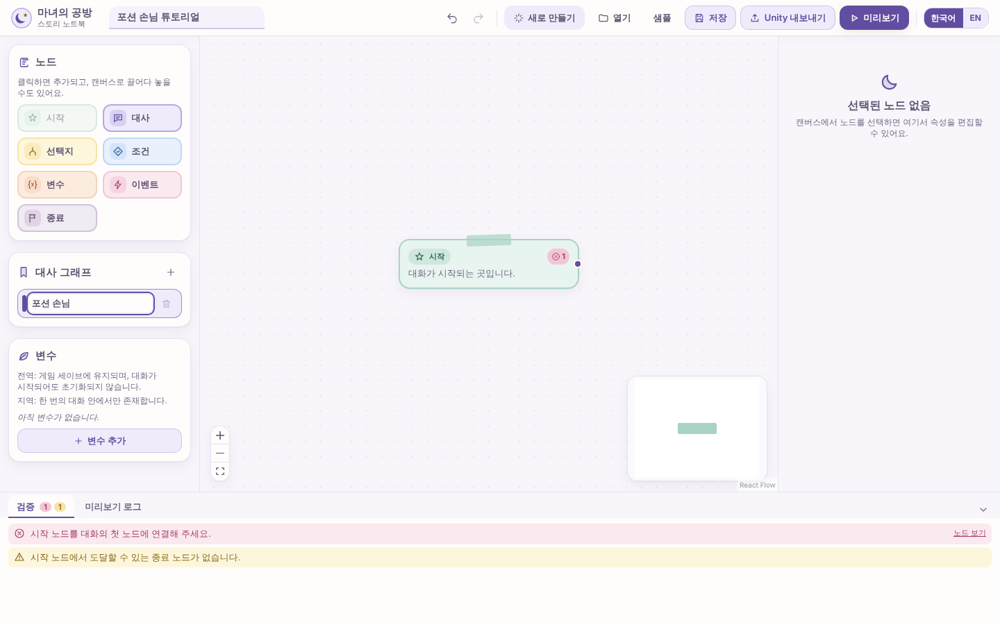

시작 노드(민트색) 하나만 놓인 빈 그래프가 준비되었습니다.

### 2단계. 변수 만들기

대화에서 쓸 변수 두 개를 만듭니다.

| 이름 | 자료형 | 범위 | 기본값 | 용도 |
|---|---|---|---|---|
| `gold` | int | 전역 | 100 | 공방의 골드 |
| `reputation` | int | 전역 | 0 | 손님들 사이의 평판 |

1. 왼쪽 **변수** 패널에서 **변수 추가**를 누릅니다.
2. 이름을 `gold`로 바꾸고 **기본값**을 `100`으로 입력합니다. (자료형 `int`, 범위 `전역`은 기본값 그대로)
3. **변수 추가**를 한 번 더 눌러 이름을 `reputation`으로 바꿉니다. (기본값 0)


> `gold`와 `reputation`은 **전역** 변수입니다. 게임 세이브에 유지되므로, 대화를 다시 시작해도 값이 초기화되지 않습니다.

### 3단계. 첫 대사 만들기

1. 시작 노드를 **클릭해서 선택**한 뒤 왼쪽 **노드** 목록의 **대사**를 클릭합니다. 시작 노드 오른쪽에 대사 노드가 생기고 자동 선택됩니다.
2. 오른쪽 **속성 편집**에서 입력합니다.
   - **화자**: `미라`
   - **대사 내용**: `안녕하세요! 기침에 잘 듣는 포션이 있을까요?`
   - **초상화 ID**: `mira`
   - **표정**: `worried`


> 지금 하단 패널에는 "시작 노드를 대화의 첫 노드에 연결해 주세요" 같은 **오류가 여러 개** 보일 수 있습니다. 아직 연결하지 않았기 때문이니 걱정하지 않아도 됩니다. 마지막에 모두 사라집니다.
>
> 

### 4단계. 선택지 두 개 만들기

1. 대사 노드가 선택된 상태에서 **선택지**를 클릭합니다.
2. 속성 편집에서
   - **선택지 1 내용**: `기침약을 만들어 드릴게요.`
   - **선택지 2 내용**: `특별한 포션을 보여 드릴까요?`


선택지 카드의 오른쪽에 번호가 붙은 출력 원 두 개가 생겼습니다.

### 5단계. 첫 번째 분기: 변수 → 이벤트 → 종료

**① 변수 노드 — 골드 +30**

1. 선택지 노드를 선택한 상태에서 **변수**를 클릭합니다.
2. 속성 편집에서 **변수**는 `gold (전역 int)`, **동작**은 `다음 값만큼 증가`, **값**은 `30`으로 설정합니다.


**② 이벤트 노드 — 아이템 지급**

1. 변수 노드가 선택된 상태에서 **이벤트**를 클릭합니다.
2. **이벤트 이름**에 `GiveItem`을 입력(또는 목록에서 선택)합니다. 필수 파라미터 `itemId`, `amount`가 자동으로 생깁니다.
3. `itemId` 값에 `cough_potion`을 입력합니다. (`amount`는 1 그대로)


**③ 종료 노드**

1. 이벤트 노드를 선택한 상태에서 **종료**를 클릭합니다.
2. **엔딩 이름**: `기침약 판매`

### 6단계. 두 번째 분기: 조건 → 이벤트/대사 → 종료

화면 왼쪽 아래 **전체 보기** 버튼을 눌러 선택지 노드가 보이게 한 뒤 진행합니다.

**① 조건 노드 — 평판이 3 이상인가?**

1. **선택지 노드를 클릭**한 뒤 **조건**을 클릭합니다. 이미 오른쪽 자리를 변수 노드가 쓰고 있으므로, 조건 노드는 그 **아래쪽**에 놓입니다.
2. **변수**: `reputation (전역 int)`, **연산자**: `>=`, **비교할 값**: `3`


**② 참 쪽: 상점 열기**

1. 조건 노드가 선택된 상태에서 **이벤트** 클릭 → **이벤트 이름** `OpenShop`
2. `shopId` 값에 `secret_shop` 입력
3. 이어서 **종료** 클릭 → **엔딩 이름** `비밀 상점 개방`

**③ 거짓 쪽: 정중한 거절**

1. **조건 노드를 다시 클릭**하고 **대사**를 클릭합니다.
2. **화자** `루미`, **대사 내용** `아직 믿을 만한 손님인지 모르겠어요. 다음에 또 오세요.`
3. 이어서 **종료** 클릭 → **엔딩 이름** `정중한 거절`

**전체 보기** 버튼을 누르면 모든 노드가 보입니다. 아직 선은 시작 노드 쪽에서만 연결되어 있지 않은 상태입니다.

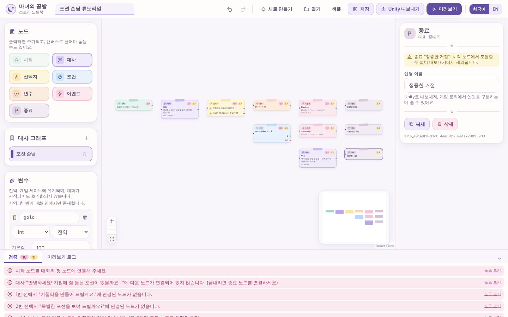

### 7단계. 노드 연결하기

각 노드의 **오른쪽 출력 원**에서 다음 노드의 **왼쪽 입력 원**으로 드래그합니다. 총 10개를 연결합니다.

| # | 출발 (출력 원) | 도착 |
|---|---|---|
| 1 | 시작 | 대사(미라) |
| 2 | 대사(미라) | 선택지 |
| 3 | 선택지 **1번** 원 | 변수(gold) |
| 4 | 선택지 **2번** 원 | 조건 |
| 5 | 변수(gold) | 이벤트(GiveItem) |
| 6 | 이벤트(GiveItem) | 종료(기침약 판매) |
| 7 | 조건 **참** | 이벤트(OpenShop) |
| 8 | 이벤트(OpenShop) | 종료(비밀 상점 개방) |
| 9 | 조건 **거짓** | 대사(루미) |
| 10 | 대사(루미) | 종료(정중한 거절) |

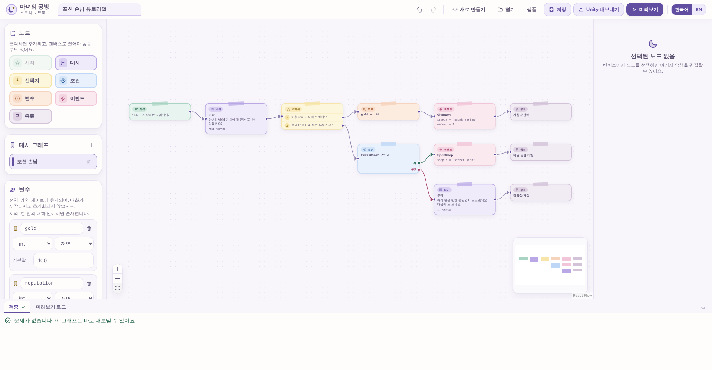

완성되면 하단 **검증** 탭에 **"문제가 없습니다. 이 그래프는 바로 내보낼 수 있어요."**가 나타납니다.


> 연결이 안 될 때는 [16장](#16-자주-하는-실수와-문제-해결)의 "선이 연결되지 않아요"를 확인하세요. 한 번 연결했다가 다른 곳으로 다시 연결하면 이전 선이 **교체**됩니다. 잘못 연결했다면 선을 클릭하고 `Delete`.

### 8단계. 미리보기

1. 상단 **미리보기**를 누릅니다.
2. 미라의 대사가 나옵니다. **다음 ▸**을 누르면 선택지가 나타납니다.
3. **"특별한 포션을 보여 드릴까요?"** 를 선택합니다.

   현재 `reputation`은 0이므로 조건이 **거짓**으로 판정되어 루미의 거절 대사가 나옵니다.

   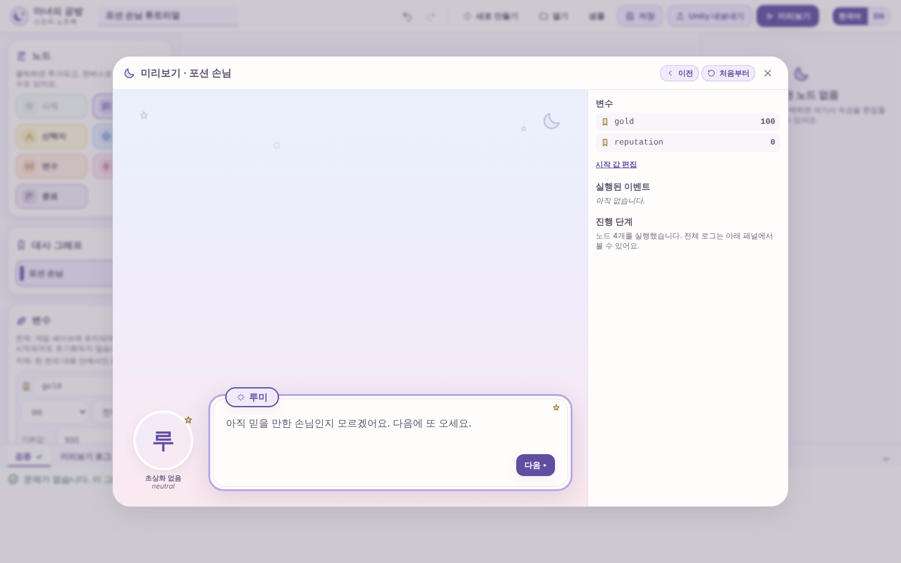

   **다음 ▸**을 누르면 `엔딩: 정중한 거절`이 표시됩니다.

   

4. 이제 **이전**/**처음부터**로 돌아가, 다른 길도 확인합니다.
   - **기침약** 선택 → 변수 패널의 `gold`가 100 → 130으로 바뀌고(노란색 강조), **실행된 이벤트**에 `GiveItem(itemId="cough_potion", amount=1)`이 나타나며 `엔딩: 기침약 판매`로 끝납니다.
5. **조건 분기를 시험**해 봅니다. 오른쪽 패널의 **시작 값 편집**을 눌러 `reputation`을 `3`으로 바꿉니다. (미리보기가 처음부터 다시 시작합니다.) 다시 진행해서 2번 선택지를 고르면:

   

   조건이 참이 되어 `OpenShop(shopId="secret_shop")` 이벤트가 실행되고 `엔딩: 비밀 상점 개방`으로 끝납니다.

   

6. 미리보기를 닫고 하단 **미리보기 로그** 탭에서 전체 흐름을 확인합니다.

   

> ✅ 확인한 엔딩: *기침약 판매*, *정중한 거절*, *비밀 상점 개방*.

### 9단계. 저장하기

1. 상단 **저장**(또는 `Ctrl+S`)을 누릅니다. `포션-손님-튜토리얼.witchproj.json` 파일이 다운로드됩니다.
2. 나중에 이어서 편집하려면 **열기**로 이 파일을 불러옵니다.


### 10단계. Unity용으로 내보내기

1. 그래프 `포션 손님`이 선택된 상태에서 **Unity 내보내기**를 누릅니다.
2. `포션-손님.dialogue.json`이 다운로드됩니다. 이 파일을 Unity 프로젝트의 `Resources` 폴더 등에 넣어 읽으면 됩니다. ([14장](#14-unity용-json-내보내기) 참고)


만약 오류가 남아 있으면 이렇게 중단 안내가 나타납니다. (예: 루미의 대사 내용을 비웠을 때)

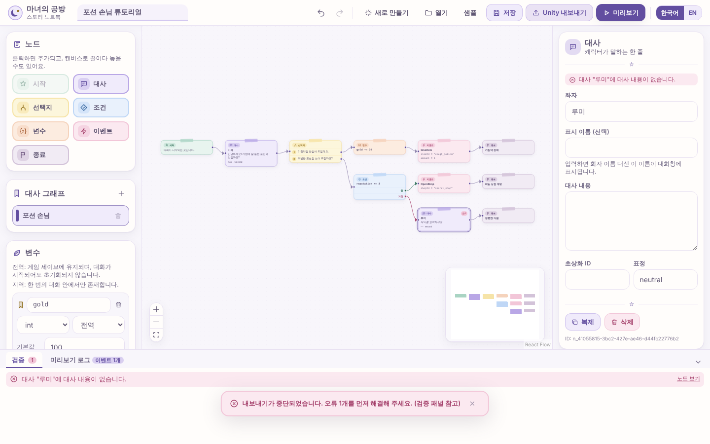

내보낸 JSON을 열어 보면 **시작 노드가 없고**, `startNodeId`가 미라의 대사 노드를 가리키며, `variables`에 `gold`와 `reputation`이 `"scope": "global"`로 들어 있는 것을 확인할 수 있습니다.

### 마무리 체크리스트

- [ ] 노드 11개, 연결 10개
- [ ] 검증 패널에 "문제가 없습니다"
- [ ] 미리보기에서 엔딩 3가지 확인
- [ ] 프로젝트 파일(`.witchproj.json`) 저장
- [ ] Unity JSON(`.dialogue.json`) 내보내기

### 더 해 보기

- **복제**로 대사 노드를 복사해 대화를 늘려 보세요. (`Ctrl+D`)
- `reputation`을 올리는 **변수 노드**를 "기침약 판매" 앞에 끼워 넣어, 단골이 될수록 비밀 상점이 열리게 만들어 보세요.
- **지역 변수**(예: `haggle`)를 만들어 흥정을 몇 번 했는지 세어 보세요. 샘플 프로젝트의 *Potion Customer*에 구현 예가 있습니다.

---

## 19. 부록: 단축키 · 용어 · 언어 전환

### 단축키

| 동작 | Windows/Linux | Mac |
|---|---|---|
| 실행 취소 | `Ctrl+Z` | `⌘Z` |
| 다시 실행 | `Ctrl+Shift+Z` / `Ctrl+Y` | `⌘⇧Z` / `⌘Y` |
| 복사 | `Ctrl+C` | `⌘C` |
| 붙여넣기 | `Ctrl+V` | `⌘V` |
| 복제 | `Ctrl+D` | `⌘D` |
| 선택 삭제 | `Delete` / `Backspace` | `Delete` / `⌫` |
| 프로젝트 저장 | `Ctrl+S` | `⌘S` |
| 키보드로 연결 | `Alt`+방향키 | `⌥`+방향키 |
| 미리보기 닫기 | `Esc` | `Esc` |
| 여러 노드 선택 | `Ctrl`+클릭, `Shift`+드래그 | `⌘`+클릭, `⇧`+드래그 |

입력 칸에 커서가 있을 때는 (저장 `Ctrl+S`를 제외하고) 단축키가 동작하지 않습니다. 글자 편집이 우선입니다.

### 용어 정리

| 용어 | 뜻 |
|---|---|
| 그래프 | 노드와 선으로 이루어진 하나의 대화 구조 |
| 노드 | 대화의 한 단계(대사, 선택지, 조건…) |
| 출력 / 입력 | 노드 오른쪽 / 왼쪽의 연결 원 |
| 분기 | 대화가 여러 갈래로 나뉘는 것 |
| 엔딩 | 종료 노드에 붙인 이름 (게임 로직에서 구분용) |
| 전역 변수 | 게임 세이브에 유지되는 변수 |
| 지역 변수 | 한 번의 대화 안에서만 존재하는 변수 |
| 프로젝트 파일 | `.witchproj.json` — 편집용 전체 데이터 |
| 내보내기 파일 | `.dialogue.json` — Unity가 읽는 실행용 데이터 |
| 속성 편집 | 선택한 노드를 수정하는 오른쪽 패널 (Inspector) |

### 언어 전환 (한국어 ↔ English)

- 도구 모음 맨 오른쪽의 **한국어 | EN** 버튼으로 전환합니다. **기본은 한국어**이며, 선택한 언어는 브라우저에 **기억**되어 다음에 열어도 유지됩니다.
- 바뀌는 것은 **화면 문구**(버튼, 안내, 오류 메시지, 미리보기 화면 등)뿐입니다.
- **바뀌지 않는 것**: 직접 입력한 대사, 변수·이벤트·엔딩 이름, 노드 종류 식별자, JSON 필드 이름, ID, 프로젝트 파일, Unity 내보내기 파일. 그래서 언어를 바꿔도 **기존 프로젝트 파일과 내보내기 결과는 그대로 호환**됩니다.
- 언어를 바꿔도 이미 표시 중인 알림(토스트) 문구는 그대로 남을 수 있습니다. 다음 알림부터 새 언어로 표시됩니다.
